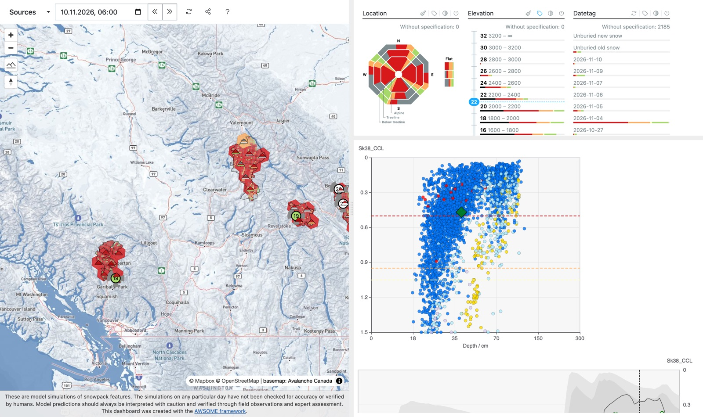
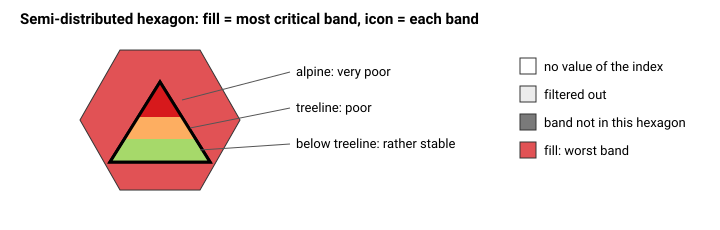
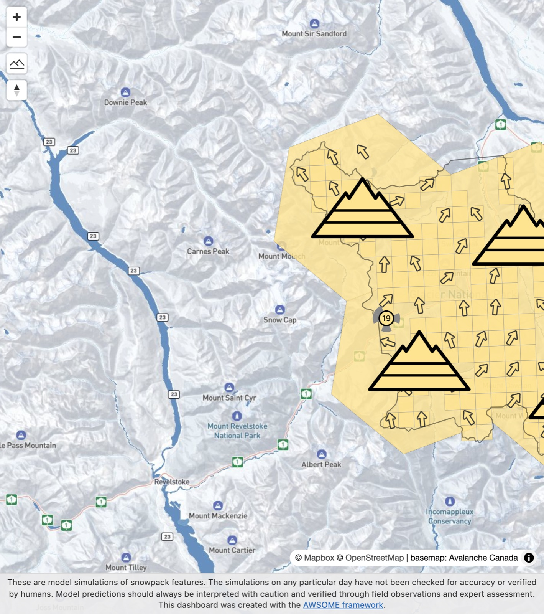
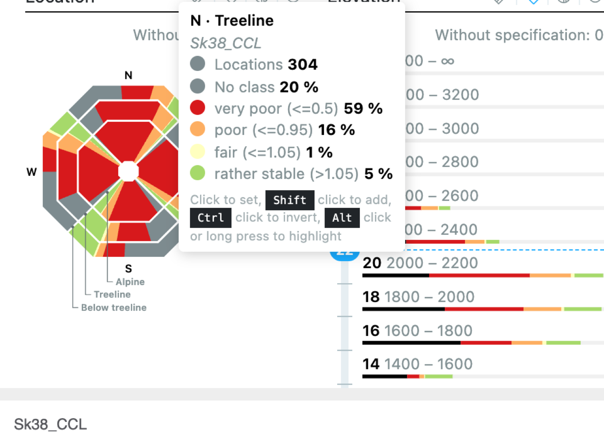

# III. Dashboard

Last updated: 10 Nov 2026

The dashboard ([snowpackbc.com](https://snowpackbc.com), [dev](https://dev.snowpackbc.com)) has a **map** on the left
and **filter panels and charts** on the right. Every panel is a filter: it counts the points in each class, and a
click on a class narrows the map to it.

<strong>Figure 1.</strong> Dashboard layout: map with sources and date (left), filter panels and hazard chart (right).

## 1. Basic workflow

1. **Check the date** (top left). Times are UTC, in 6 h steps. The default is today 06:00 UTC (22:00 Pacific the
   evening before). `«` / `»` step back and forward; the forecast reaches 48 h ahead.
2. **Choose the sources** (Sources menu): Semi-Distr. (hexagons), Fully gridded, Stations. Each can be switched per
   operation.
3. **Look at the colours.** One filter **classifies** the map. Its classes colour the hexagons, cells and icons. The
   default is **Sk38_CCL**. Use the colour icon in a panel header to classify by another filter, e.g. Punstable,
   New snow 24 h or Wind.
4. **Narrow down** with the panels: click classes in the **Location** rose (aspect × band), the elevation bars, a
   datetag, a grain type… The map, the counts and the charts follow.
5. **Open a point:** hover for the tooltip, click for the details (profile, time series).

## 2. Map

### 2.1 Semi-distributed hexagons

- Each hexagon is filled with the colour of its **most critical band** for the classifying filter.
- The **mountain icon** in its centre has three levels, from the bottom: below treeline, treeline, alpine. Each level
  shows the class of that band.
  - **White:** no value of the classifying index.
  - **Light grey:** filtered out by the current selection.
  - **Dark grey:** the band does not exist in this hexagon (no terrain in that elevation range).
- Hovering a level shows that band's tooltip; a click opens its details.
- When several aspects of a band are shown, the most critical aspect counts.

<strong>Figure 2.</strong> How to read a hexagon: its fill is the most critical band, the icon shows each band (bottom = below treeline).

### 2.2 Fully gridded cells

- Each 2.5 km cell is filled with its most critical selected aspect.
- Thin grey lines mark the cells; the black line is the operation's outline.
- No icon.

### 2.3 Stations

- Point markers, one per station and slope (8 aspects + flat).
- The marker label shows the classifying value.

### 2.4 Wind arrows

- **When they show:** while **Wind 24 h mean** or **Gust 24 h max** classifies the map, or has a class selected.
- **What they show:** one arrow per hexagon (in its upper part, clear of the icon), per grid cell and per station.
  - **Direction:** the arrow points **downwind**, i.e. where the wind blows to. The Wind direction filter counts where
    it blows **from**.
  - **Size:** grows with the speed.
  - **Colour:** the wind class.
- Where arrows would overlap, the strongest wind is kept.

<strong>Figure 3.</strong> Classified by Wind 24 h mean (dev): arrows point downwind; here a light SW to S wind over Rogers Pass.

## 3. Filter panels

| Panel | Chart | Notes |
|---|---|---|
| **Location** | Aspect / elevation rose | Octagon: wedges = aspects (N/E/S/W, ±45°), rings = bands (alpine inside). Equal-area rings, so every cell has the same weight. Flat as a column beside it. Tooltip: aspect · band, the classifying filter, number of points, each class in %. |
| **Elevation** | Bars, 200 m steps | Point elevation |
| **Datetag** | Bars | Burial date of the critical layer of the active stability index |
| **Sk38_CCL, Punstable** | Bars | Dry stability indices |
| **LWC index, Pwet** | Bars | Wet stability indices |
| **New snow 24 h / 48 h, Rain 24 h** | Bars | Weather of the last 24 / 48 h |
| **Wind 24 h mean, Gust 24 h max** | Bars | Avalanche Canada wind classes; wind arrows on the map |
| **Wind direction 24 h** | Rose, 8 sectors | Where the wind came from |
| **Air temperature** | Bars | At the time step |
| **Snowline, Snow level MSC** | Bars, 250 m steps | Our rain/snow line and MSC's snow level, for comparison |

<strong>Figure 4.</strong> The Location rose: hovering a cell shows aspect · band, the classifying filter, the number of points and each class in %.

Every filter is explained in [Look up](look-up.md).

### 3.1 Clicks

| Action | Effect |
|---|---|
| Click a class | Select only that class (click again to clear) |
| Shift + click | Add the class to the selection |
| Ctrl + click | Invert: everything except that class |
| Alt + click / long press | Highlight instead of filter |
| Aspect label on the rose | Select all bands of that aspect |
| Band label on the rose | Select that band in every aspect |
| Colour icon in a header | Classify the map by this filter |
| Reset icon in a header | Clear that filter |

**Without specification** counts the points that have no value for this filter. Example: the snowline when no
precipitation fell, or the MSC snow level before 12 Oct 2026.

## 4. Charts

### 4.1 Hazard chart

- **Y-axis:** the classifying stability index.
- **X-axis:** the depth / size estimate of its critical layer.
- **Points:** every selected point is a dot coloured by its class. The dashed lines are the class limits.
- Hovering the map highlights the point in the chart.

### 4.2 Time series

- For the selected point: the index of the active stability regime over the last 14 days and the next 3.

Code: the dashboard is AWSOME's [albina-admin-gui](https://gitlab.com/avalanche-warning/visualization/albina-admin-gui) (branch `awsome`) with the snowpackbc patches; the aspect / elevation rose is proposed upstream on branch [2-aspect-elevation-rose](https://gitlab.com/avalanche-warning/visualization/albina-admin-gui/-/tree/2-aspect-elevation-rose).

## 5. Sharing a view

- The URL keeps the date, sources, selections and classifying filter.
- The share icon (top) copies it.
- Example: `…/#/modelling/awsome?classify=vw24` opens the dashboard classified by mean wind.
