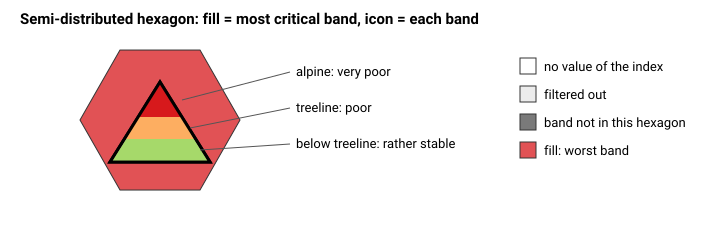

# Get Started

Five steps from opening [snowpackbc.com](https://snowpackbc.com/#/modelling/awsome){target=_blank} to a useful
picture. The **map** is on the left, the **panels and charts** are on the right.

!!! tip "The key idea: every panel is a filter"
    Each panel counts the points in each of its classes. Click a class, and the map, the counts in every other
    panel and the charts show only those points.

## 1. Pick the Time

The date box at the top left shows the time step. Times are **UTC**, in 6 h steps.

- The default is **today 06:00 UTC**, which is 22:00 Pacific the evening before.
- ++shift+left++ / ++shift+right++ or the `«` `»` buttons step back and forward. The forecast reaches **48 h ahead**.
- ++shift+r++ reloads the data.

??? info "Past vs. future"
    Steps before today's 06:00 UTC use the weather model's analysis (*nowcast*). Later steps use the 48 h forecast.
    [How the weather is assembled →](model-chain.md#3-hrdps-downscaled)

## 2. Choose What to Show

Open **Sources** (top left) and switch on what you need, separately for each operation:

| Source | Shows | Best for |
|---|---|---|
| **Semi-Distr.** | 15 km hexagons, one value per elevation band | a regional overview, like a bulletin |
| **Fully gridded** | 2.5 km cells | detail within an operation |
| **Stations** | one marker per station and slope | comparing with what the station measured |

[What each one looks like on the map →](map.md)

## 3. Read the Colours

**One variable colours the map.** By default it is [Sk38_CCL](panels.md#sk38_ccl), the dry-snow stability index:

Very Poor Poor
Fair Rather Stable

The badge at the top right of the map names the variable that colours the map and the one that labels it. To colour
by something else, e.g. New Snow 24 h or Wind 24 h Mean, click the **Classify** button
(:material-brush-variant:) in that panel's header.

{ width="420" align=right }

On a hexagon, the **fill** shows its most critical band. The **mountain icon** shows each band separately, from the
bottom up: below treeline, treeline, alpine.
[More on reading hexagons →](map.md#hexagons)

## 4. Narrow Down

Click classes in the panels to filter the map. Combine as many panels as you like:

| Do this | To get |
|---|---|
| **Click** a class | only that class (click again to clear it) |
| ++shift++ + click | add a class to the selection |
| ++ctrl++ + click | everything *except* that class |
| ++alt++ + click, or long press | highlight it instead of filtering |
| :material-power: **Reset** in a panel header | clear that panel's filter |

Example: in **Aspect & Elevation**, click *N · Alpine*, then ++shift++ + click *E · Alpine* to see north and east
facing alpine slopes only.

[All panels and buttons →](panels.md)

## 5. Open a Point

- **Hover** a hexagon band, cell or station to see its values.
- **Click** it to open the snow profile and the [time series](panels.md#time-series).
- While you hover the map, the point is highlighted in the [hazard chart](panels.md#hazard-chart).

---

**Next:** [Read the Map](map.md) · [How Do I…](how-do-i.md) recipes
