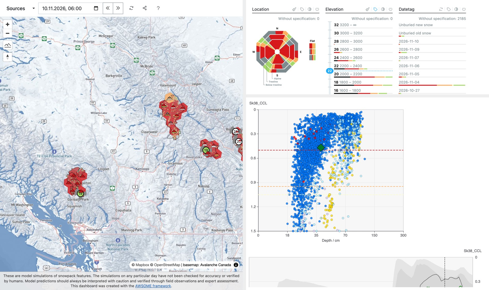

---
hide:
  - navigation
  - toc
---

# AWSOME BC User Guide

How to read the snowpack dashboard at **[snowpackbc.com](https://snowpackbc.com/#/modelling/awsome){target=_blank}**.
Every day, the HRDPS weather forecast drives SNOWPACK simulations for four operations in western Canada:
Rogers Pass, Mike Wiegele Heliskiing, Whistler and Banff. The dashboard shows the simulated layering, stability
and weather.

!!! danger "Model output, not observations"
    Everything on the dashboard is a simulation driven by a weather forecast. Nobody checks it for accuracy on any
    day. Use it together with field observations and expert judgement.

-   :material-rocket-launch:{ .lg .middle } **New here?**

    ---

    A 5-minute tour: pick a date, choose what to show, read the colours, narrow down.

    [:octicons-arrow-right-24: Get Started](get-started.md)

-   :material-hexagon-multiple-outline:{ .lg .middle } **What am I looking at?**

    ---

    Hexagons, grid cells, stations, the mountain icon and wind arrows.

    [:octicons-arrow-right-24: Read the Map](map.md)

-   :material-chart-bar:{ .lg .middle } **What does this panel mean?**

    ---

    One card per panel: what it tells you, what the colours mean, what to watch out for.

    [:octicons-arrow-right-24: Panels & Charts](panels.md)

-   :material-lightbulb-on-outline:{ .lg .middle } **How do I…?**

    ---

    Short recipes, e.g. "find lee slopes loaded by new snow" or "follow one buried layer".

    [:octicons-arrow-right-24: How Do I…](how-do-i.md)

## The Dashboard at a Glance

Hover a number to see what that part does, or click it to read more.

<a class="hotspot" style="left:3.5%;top:7%" href="get-started/#2-choose-what-to-show" data-tip="Sources: switch hexagons, grid cells and stations on or off for each operation">1</a>
<a class="hotspot" style="left:13%;top:7%" href="get-started/#1-pick-the-time" data-tip="Date and time (UTC, 6 h steps). « » or Shift+←/→ step through time, up to 48 h ahead">2</a>
<a class="hotspot" style="left:31.5%;top:2.8%" href="how-do-i/#share-what-im-looking-at" data-tip="Share: copies a link to exactly this view">3</a>
<a class="hotspot" style="left:37%;top:34%" href="map/#hexagons" data-tip="The map: hexagons, grid cells and stations, coloured by one variable">4</a>
<a class="hotspot" style="left:61.5%;top:2.8%" href="panels/#panel-buttons" data-tip="Panel buttons: Classify, Label, Invert, Reset">5</a>
<a class="hotspot" style="left:52%;top:8.5%" href="panels/#aspect-elevation" data-tip="Aspect & Elevation rose: click a slice to show only that aspect and band">6</a>
<a class="hotspot" style="left:69.5%;top:31%" href="panels/#elevation" data-tip="Elevation, with the elevation cut: everything above or below one elevation">7</a>
<a class="hotspot tip-left" style="left:88%;top:12%" href="panels/#datetag" data-tip="Datetag: when the critical layer was buried">8</a>
<a class="hotspot tip-up" style="left:63%;top:52%" href="panels/#hazard-chart" data-tip="Hazard chart: stability against depth, one dot per point">9</a>
<a class="hotspot tip-up" style="left:62%;top:92%" href="panels/#time-series" data-tip="Time series of the selected point: 14 days back, 3 ahead">10</a>

1. [**Sources**](get-started.md#2-choose-what-to-show): hexagons, grid cells, stations
2. [**Date & time**](get-started.md#1-pick-the-time): UTC, 6 h steps, up to 48 h ahead
3. [**Share**](how-do-i.md#share-what-im-looking-at): copy a link to this view
4. [**Map**](map.md): coloured by the variable chosen with Classify
5. [**Panel buttons**](panels.md#panel-buttons): Classify · Label · Invert · Reset
6. [**Aspect & Elevation**](panels.md#aspect-elevation): pick aspects and bands
7. [**Elevation**](panels.md#elevation): 200 m bars and the elevation cut
8. [**Datetag**](panels.md#datetag): burial date of the critical layer
9. [**Hazard chart**](panels.md#hazard-chart): stability vs. depth
10. [**Time series**](panels.md#time-series): history and forecast of one point

## Three Views of the Same Snowpack

All three use the same weather input. They differ in where SNOWPACK runs. [How it's made →](model-chain.md)

| | Semi-distributed (hexagons) | Fully gridded | Stations |
|---|---|---|---|
| **One point per** | 15 km hexagon × elevation band | 2.5 km HRDPS cell | weather station |
| **Weather** | median of the hexagon's HRDPS cells | the cell's own HRDPS | station measurements, HRDPS fills gaps |
| **Slopes** | flat + 38° N, E, S, W | flat + 38° N, E, S, W | flat + 8 aspects |
| **Best for** | a quick regional overview, like a bulletin | detail within an operation | comparing with observations |

## Links

- **Dashboard:** [snowpackbc.com](https://snowpackbc.com) (main, the checked version) ·
  [dev.snowpackbc.com](https://dev.snowpackbc.com) (new features first)
- **AWSOME:** [GitLab group](https://gitlab.com/avalanche-warning) ·
  [wiki](https://gitlab.com/groups/avalanche-warning/-/wikis/home) ·
  [Understanding AWSOME](https://gitlab.com/groups/avalanche-warning/-/wikis/home/Tutorials/Understanding-AWSOME)
- **Weather model:** [HRDPS (ECCC/MSC)](https://eccc-msc.github.io/open-data/msc-data/nwp_hrdps/readme_hrdps_en/) ·
  [MSC Datamart](https://dd.weather.gc.ca/)
- **Snow model:** [SNOWPACK (SLF)](https://www.slf.ch/en/services-and-products/snowpack/)
- **Related guide:** [Avalanche Canada & CAIC Models User Guide](https://docs.google.com/document/d/1RcfzdmBYc0Rx-czn1QZ2xS7nVgSdf_0gwwLDmI19XsI/edit)

??? quote "Credits"
    AWSOME is developed by the AWSOME core team
    ([gitlab.com/avalanche-warning](https://gitlab.com/avalanche-warning)). snowpackbc adds the BC setup on top of it:
    HRDPS ingest and downscaling, hexagon and grid domains, station feeds, weather filters, the Aspect & Elevation rose
    and the semi-distributed map display.

    AWSOME Core Team (2024). *AWSOME: Avalanche Warning Service Operational Meteo Environment* [software].
    <https://gitlab.com/avalanche-warning>
