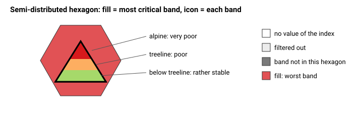
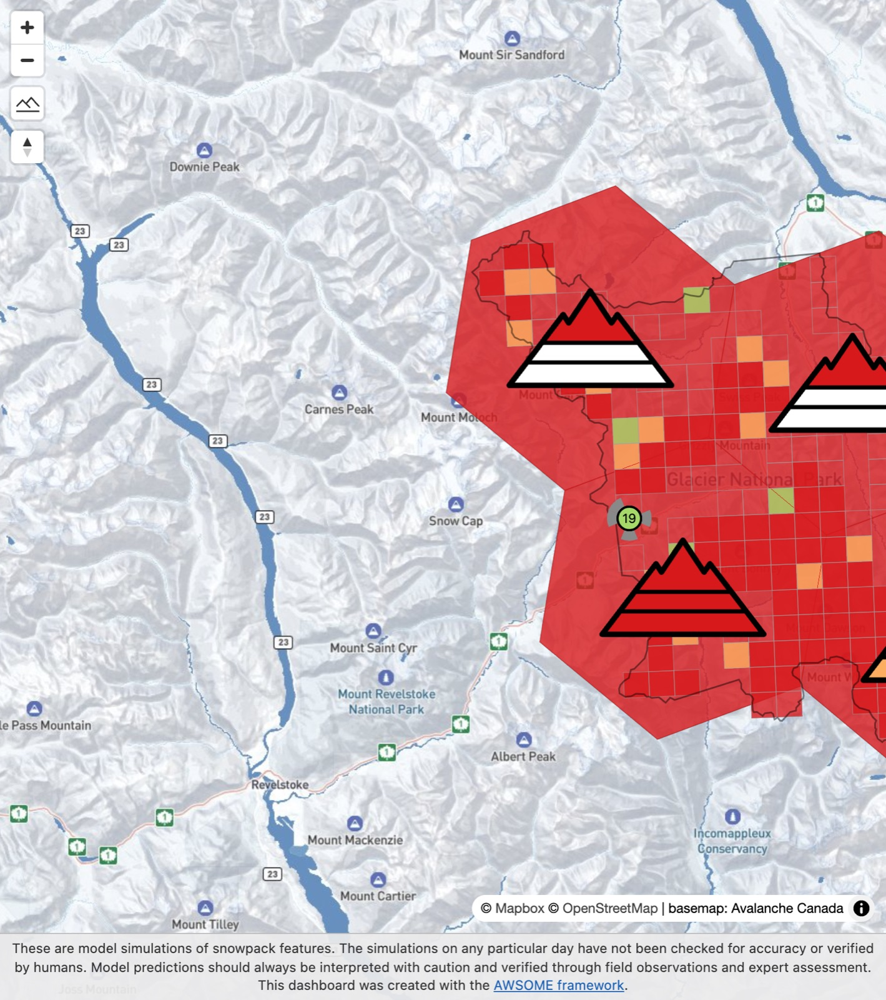
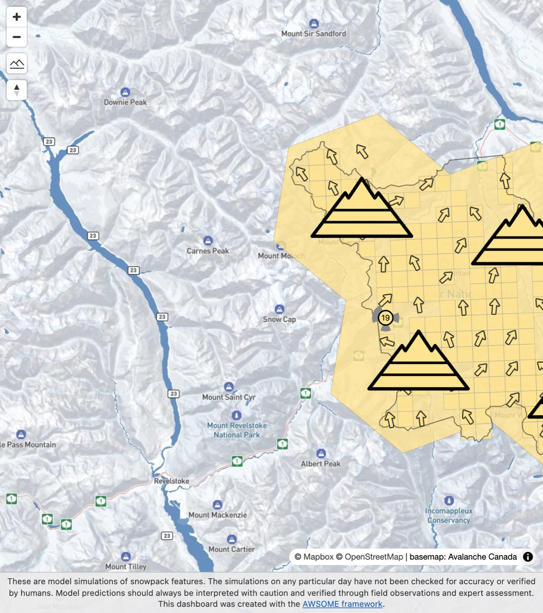

# Read the Map

The map shows up to three sources. All of them are coloured by the same variable: the one picked with
**Classify** (default [Sk38_CCL](panels.md#sk38_ccl)). Points that the current filters exclude are greyed out.

## Hexagons

*Source: Semi-Distr.* Each 15 km hexagon gets one simulation per elevation band.

**Fill:** the colour of the hexagon's **most critical band**.

**Mountain icon:** one level per band, from the bottom: **below treeline → treeline → alpine**. Each level shows
that band's class.

| Level colour | Meaning |
|---|---|
| White | no value for the variable that colours the map |
| Light grey | removed by the current filters |
| Dark grey | the band doesn't exist here (no terrain in that elevation range) |

**Hover** a level for that band's values. **Click** it for its details. If several aspects are selected, the most
critical aspect counts.

## Grid Cells

*Source: Fully gridded.* One simulation per 2.5 km HRDPS cell.

- Each cell is filled with its **most critical selected aspect**.
- Thin grey lines mark the cells. The black line is the operation's outline.
- Cells have no icon. Their band follows from their elevation.

## Stations

*Source: Stations.* One marker per station and slope (flat + 8 aspects). The marker label shows the value of the
labelling variable (see the badge at the top right of the map). [List of stations →](operations.md)

## Wind Arrows

Arrows appear while **Wind 24 h Mean** or **Gust 24 h Max** colours the map or has a class selected.

- **Direction:** the arrow points **downwind**, i.e. where the wind blows *to*. The arrowhead points at the lee
  slopes.
- **Size:** grows with the speed.
- **Colour:** the wind class.
- One arrow per hexagon (in its upper part, clear of the icon), grid cell and station. Where arrows would overlap,
  the strongest wind is kept.

!!! warning "Opposite conventions"
    The arrows show where the wind blows **to**. The [Wind Direction 24 h](panels.md#dw24) panel counts where it
    blows **from**.

## Map Controls

| Control | Does |
|---|---|
| :material-plus: / :material-minus: | zoom |
| :material-image-filter-hdr: | 3D terrain on or off |
| :material-navigation: compass | drag to rotate, click to point north again |
