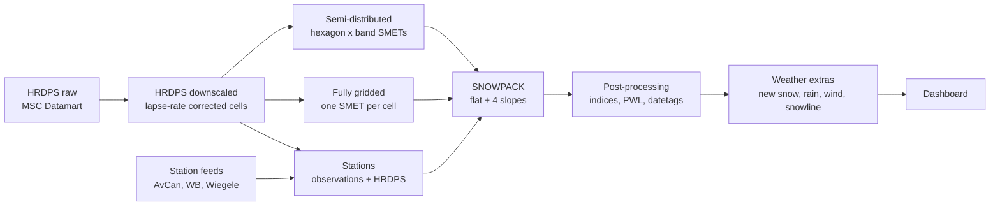
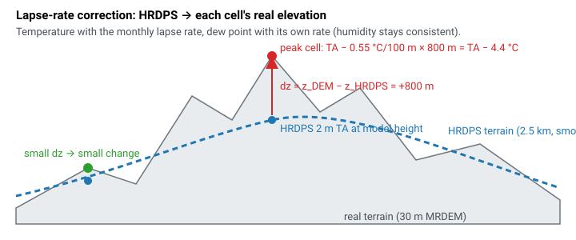
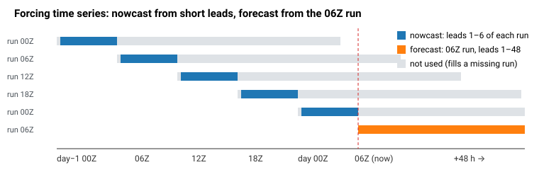
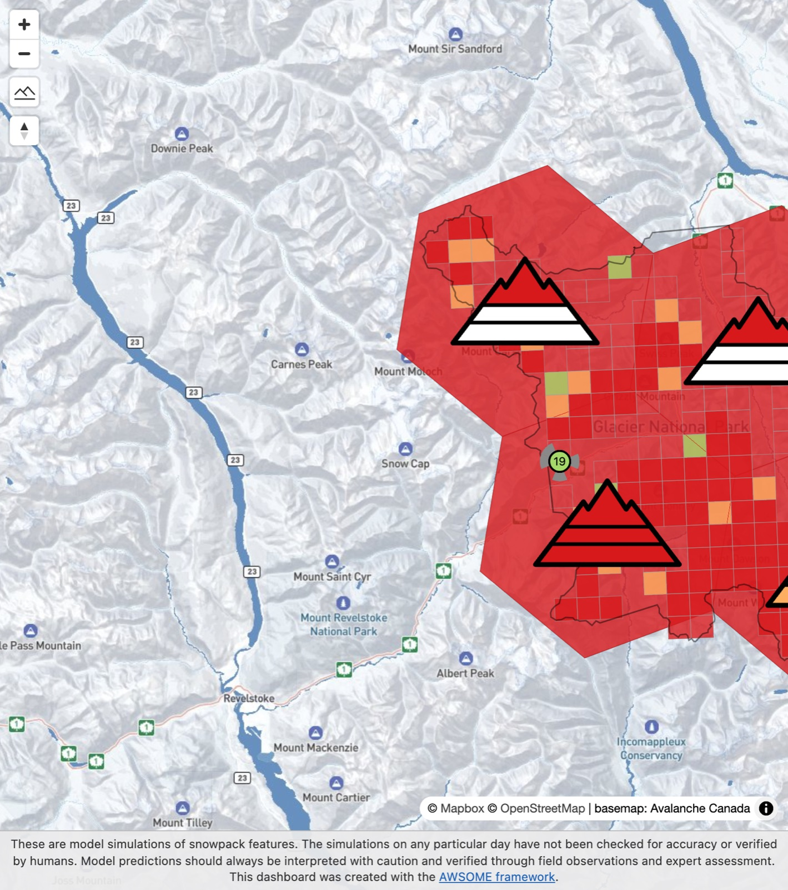

# II. Model Chain

Last updated: 10 Nov 2026

All three tool chains share one weather input: HRDPS, downloaded once and corrected once. They differ in **where**
SNOWPACK is run (hexagon × band, grid cell, station) and in **which data** drives it.

## 1. Daily schedule

Last updated: 10 Nov 2026

A timer on the worker starts the daily run early in the morning (10:00 UTC), with a retry later. It uses that day's
**06Z HRDPS run** and processes hexagons first, then the full grid, then stations, so a problem further down never
holds back the hexagons. Main is published after dev in the same run; stations are on dev only for now.

| Step | What happens |
|---|---|
| fetch | Wait for the 06Z HRDPS run on Datamart, clip it to BC/Alberta, archive it |
| correct | Lapse-rate correction of every new run to each cell's real elevation; gust and MSC snow level as side products |
| smet | Assemble the hourly forcing per point (nowcast + 48 h forecast), refuse to run on gaps |
| model | `atoolchain` per domain: SNOWPACK and AWSOME's post-processing |
| extras | Weather values for the dashboard filters |
| dcfg / publish | Dashboard config, upload to dev then main |
| warm / state | Pre-load the API caches; save the snowpack state for the next day |

## 2. HRDPS raw

Last updated: 10 Nov 2026

- **Model:** ECCC/MSC **HRDPS**, 2.5 km, 4 runs per day (00/06/12/18Z), hourly leads 0–48.
- **Source:** MSC Datamart. The fetcher checks every 30 min and archives each complete run once.
- **Clip:** a BC/Alberta box (−132…−110° lon, 48…57° lat), cut on the native rotated grid. Values are not changed.
- **Variables (SNOWPACK forcing):** 2 m air temperature (TA), 2 m relative humidity (RH), 10 m wind speed (VW) and
  direction (DW), incoming shortwave (ISWR) and longwave (ILWR) radiation, precipitation (PSUM, WEonG APCP).
- **Also archived:** 10 m wind gust (GUST) and model terrain height (HGT).
- **Season start:** the archive starts 4 Oct 2026, so the simulations start on that day.

## 3. HRDPS downscaled

Last updated: 10 Nov 2026

Every run is turned into hourly time series for **1662 points**: the HRDPS cells of the four operations. Each point's
elevation comes from the 30 m MRDEM.

1. **Nearest cell:** each point takes the nearest HRDPS grid point.
2. **Units:** K → °C, accumulated precipitation and radiation → hourly values.
3. **Lapse-rate correction:** temperature and humidity are moved from the HRDPS terrain height to the point's real
   elevation (`dz = z_DEM − z_HRDPS`) with monthly lapse rates (November: −0.55 °C per 100 m). The dew point is moved
   with its own monthly rate, so humidity stays physically consistent.

<strong>Figure 1.</strong> Lapse-rate correction: HRDPS gives 2 m temperature at its smoothed terrain height; each cell is moved to its real elevation (30 m DEM). Peaks get colder, valleys warmer.

4. **Stitching:** the **nowcast** takes each hour from the newest run that covers it with a short lead (1–6 h). The
   **forecast** is the 06Z run, leads 1–48. A missing run is filled from the next older one. A gap stops the run,
   because missing precipitation would otherwise turn into 0 mm.

<strong>Figure 2.</strong> How the hourly forcing is assembled: the past from the first 6 hours of each run, the next 48 h from the 06Z run.

Side products for the dashboard, not used by SNOWPACK:

- **Gust:** HRDPS 10 m gust at each point (no correction).
- **MSC snow level:** the WEonG `HGTSNLVL` field at each point, defined only where precipitation is forecast.

## 4. Regions and points

Last updated: 10 Nov 2026

### 4.1 Semi-distributed (hexagons)

- The operation is covered by **15 km hexagons**.
- A cell belongs to hexagon H and band B if its centre lies inside H and its elevation lies in B. Band limits differ
  per operation (see [Home](index.md#1-operations)).
- One SNOWPACK point per hexagon and band: the hourly **median** of its member cells (circular mean for wind
  direction), at the median member elevation.
- Location id `<hexagon>_<band>`, e.g. `R1_ALP`. Region id = hexagon.

<strong>Figure 3.</strong> Rogers Pass zoomed in: 15 km hexagons with their mountain icons, the 2.5 km grid cells underneath, and the Fidelity station marker.

### 4.2 Fully gridded

- One SNOWPACK point per HRDPS cell of the operation whose elevation lies inside the operation's bands. Each point
  uses the cell's own corrected series.
- The band of each cell follows from its elevation. The map draws the cells as polygons, with the operation's
  outline.

### 4.3 Stations

- One point per station, at the station's elevation.
- Per field and hour the first valid value wins: **station observation → HRDPS** (nearest cell, moved to the station
  elevation; precipitation +5 % per 100 m). Radiation is always HRDPS.
- Quality control as in last season's notebooks (e.g. RH < 5 % counts as missing).
- 8 aspects at 38° plus flat.

## 5. SNOWPACK

Last updated: 10 Nov 2026

- AWSOME's `atoolchain` runs SNOWPACK for each domain with the `nwp` flavour, precipitation-driven (no snow depth
  assimilation).
- **Slopes:** flat plus 38° N/E/S/W from the same weather series (stations: 8 aspects).
- **Resume:** every day continues from yesterday's saved snow state. The last three days are recomputed with the
  newest analysis, then the forecast is added.
- **Output:** `snowpack.zarr` (time series, every 3 h) and `xsnowpack.zarr` (full layer profiles).

## 6. Post-processing tools

Last updated: 10 Nov 2026

AWSOME's post-processing runs inside `atoolchain` after SNOWPACK:

| Tool | Code |
|---|---|
| atoolchain (runs everything) | [atoolchain](https://gitlab.com/avalanche-warning/snow-cover/model-chains/atoolchain) |
| Punstable | [punstable](https://gitlab.com/avalanche-warning/snow-cover/postprocessing/instability/punstable) |
| PWL | [pwl](https://gitlab.com/avalanche-warning/snow-cover/postprocessing/instability/pwl) |
| Datetags | [datetags](https://gitlab.com/avalanche-warning/snow-cover/postprocessing/instability/datetags) |
| Pwet | [pwet](https://gitlab.com/avalanche-warning/snow-cover/postprocessing/pwet) |

| Step | Output |
|---|---|
| **indices** | Stability indices per layer: `rc_flat`, `sk38`, `lwc`, `punstable`, `rta`, `sk38_ccl`, `sk38_ccl_rta` |
| **pwl** | Persistent weak layers: SH, DH, FCxr, FC layers; unstable when Punstable ≥ 0.77 (only FCxr/FC go through that threshold) |
| **datetags** | Groups layers by the precipitation event that buried them, per region and band (e.g. "2026-10-24") |
| **simplified** | One summary per location, slope and time step: the most critical layer per index with its depth, grain type, datetag and size estimate |
| **dashboard** | GeoJSON files (every 6 h, whole season, one file per aspect) and the dashboard config |

snowpackbc then adds:

- **Weather extras** (`geojson_extras.py`): new snow 24/48 h, rain 24 h, wind, gust, air temperature, snowline, MSC
  snow level. See [Look up](look-up.md#3-weather).
- **Dashboard config**: semi-distributed display, the aspect / elevation rose ("Location"), weather filters,
  classification by Sk38_CCL by default.

## 7. Dashboard

Last updated: 10 Nov 2026

- A static site (AWSOME's dashboard frontend `albina-admin-gui` with the snowpackbc patches) is served from S3 behind
  CloudFront.
- Time series and profile views come from AWSOME's API and nivix on the worker.
- **Dev** gets new features first; **main** follows once checked.

See [Dashboard](dashboard.md).
