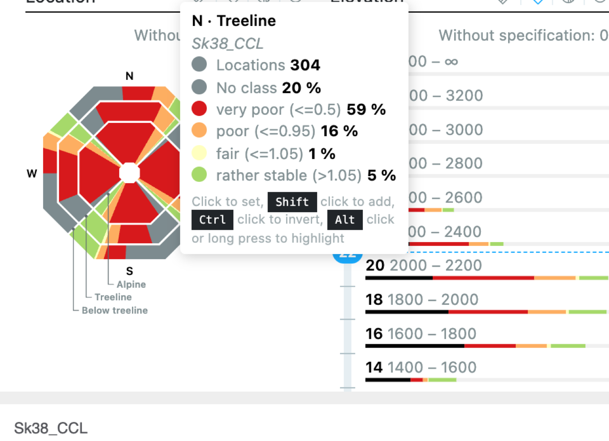
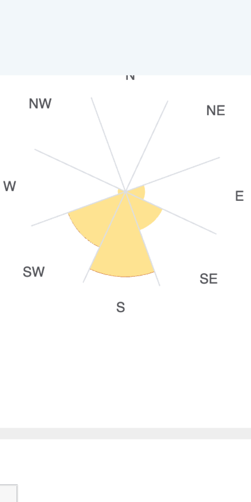
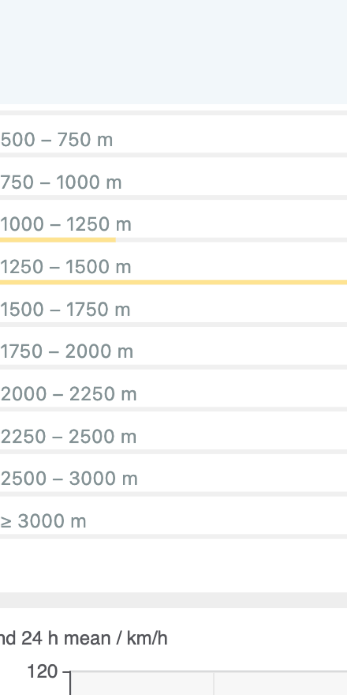
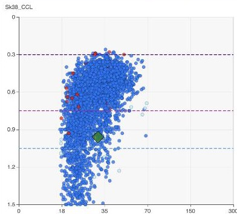

# Panels & Charts

There is one card for each panel on the right side of the dashboard, in the same order. Each card starts with what
the panel tells you and how to read it. The technical details are folded away at the bottom.

**Location:** [Aspect & Elevation](#aspect-elevation) · [Elevation](#elevation) · [Datetag](#datetag) ·
**Stability:** [Sk38_CCL](#sk38_ccl) · [Punstable](#punstable) · [LWC Index](#lwc) · [Pwet](#pwet) ·
[Avalanche Problem](#grain-type) ·
**Weather Data:** [New Snow 24 h](#hn24) · [New Snow 48 h](#hn48) · [Rain 24 h](#rain24) ·
[Wind 24 h Mean](#vw24) · [Wind Direction 24 h](#dw24) · [Gust 24 h Max](#gust24) · [Air Temperature](#ta) ·
[Snowline](#snowline) · [Snow Level MSC](#snlvl) ·
**Charts:** [Hazard Chart](#hazard-chart) · [Weather Series](#weather-series) · [Time Series](#time-series) ·
**Map:** [Snowpack Summary](#snowpack-summary)

## Panel Buttons { #panel-buttons }

Every panel header has the same four buttons:

| Button | Name | Does |
|---|---|---|
| :material-brush-variant: | **Classify** | colour the map by this variable |
| :material-tag-outline: | **Label** | show this variable as labels on the map |
| :material-circle-half-full: | **Invert** | swap the selection: everything that is not selected |
| :material-power: | **Reset** | clear this panel's filter |

Click a class to select only that class. ++shift++ + click adds a class, ++ctrl++ + click selects everything except
that class, and ++alt++ + click (or a long press) highlights a class instead of filtering.

**Without specification** counts the points that have no value. Examples: the snowline when no precipitation fell,
or the datetag when there is no critical layer.

!!! note "Reading the classes"
    For weather classes, the lower limit is included and the upper one is not: 5–10 cm means at least 5 cm and less
    than 10 cm. **24 h** always means the 24 hours ending at the time step shown, forecast steps included.

---

## Location

### Aspect & Elevation { #aspect-elevation }

**What it tells you:** *where in the terrain* the selected conditions are. It is the aspect × elevation band view
from the avalanche bulletin, and it is usually the first place to narrow down: "only north to east, alpine".

**How to read it**

- **Wedges** are aspects (N, E, S, W, each ±45°). **Rings** are bands: alpine in the centre, below treeline on the
  outside. **Flat** is the column on the right.
- Each slice shows how its points split into the classes of the variable that colours the map. A slice that is
  mostly dark purple under Sk38_CCL is where the model finds the weakest snowpack.
- The rings have **equal area**, so every slice carries the same visual weight, whatever its band.
- **Hover** a slice: aspect · band, the colouring variable, the number of points and each class in %.

**Clicks**

- A slice → that aspect and band.
- An aspect label (N, E, …) → all bands of that aspect.
- A band label (Alpine, …) → that band in every aspect.

??? abstract "Technical details"
    | | |
    |---|---|
    | Key | `aspect` × `band` (cells such as `N|alpine`) |
    | Aspect | the simulated slope: flat or 38° N/E/S/W (stations: 8 aspects) |
    | Band | elevation band of the point, from the region GeoJSON (30 m vegetation-based DEM, so treeline follows vegetation) |
    | Band limits | depend on the operation, see [Operations](operations.md) |

### Elevation { #elevation }

**What it tells you:** how the selected points are spread over elevation, in 200 m steps. Use it to see at which
elevations a problem sits, e.g. whether new snow or a weak layer only shows up above a certain height.

&lt; 140014001600
180020002200
240026002800
30003200 +

- The bars are coloured from forest greens at low elevations through light green near treeline to blues in the
  alpine, matching the ALP · TL · BTL legend.
- **Elevation cut:** the blue marker (e.g. **22** = 2200 m) selects everything above or below that elevation in one
  click.

??? abstract "Technical details"
    | | |
    |---|---|
    | Key | `elevation` |
    | Source | point elevation (30 m MRDEM, median of the member cells) |
    | Classes | < 1400, then 200 m steps up to 3200 + |

### Datetag { #datetag }

**What it tells you:** *when* the critical layer was buried. Weak layers are often named after the date they were
buried ("the 24 October layer"). The datetag gives each point's critical layer that name, so you can follow one
layer across the operation and through time.

Unburied new snow Unburied old snow
2026-10-24 2026-11-10 …

**How to read it**

- Each bar is a burial date: the precipitation event that buried the layer. The longer a bar, the more points have
  their critical layer on that date.
- **Unburied new snow** and **Unburied old snow** (yellow) mark critical layers that are still at the surface. The
  problem is in the recent snow, not in a buried layer.
- The datetag belongs to the stability index that currently colours the map. Switch from Sk38_CCL to Punstable and
  the critical layers, and therefore the datetags, can change.

[Recipe: follow one buried layer →](how-do-i.md#follow-one-buried-weak-layer)

??? abstract "Technical details"
    | | |
    |---|---|
    | Key | `snowpack.<index>.instabilityDrivenBy` |
    | Method | layers grouped by the precipitation event that buried them, per region and band |
    | Code | [datetags](https://gitlab.com/avalanche-warning/snow-cover/postprocessing/instability/datetags) · [Herla et al. (2024), ISSW](https://gitlab.com/avalanche-warning/universal/archive/resources/-/raw/main/HerlaOthers2024_ISSW_Postprocessing.pdf) |

---

## Stability

Each index picks **one layer per point**: its most critical one. The Datetag and the depth in the hazard chart
describe that same layer, for the index that currently colours the map.

All four indices share the same colours. Each class fades from a strong colour at its unstable end to a lighter
one at its stable end, so the shade also shows where a value sits within its class.

Very Poor Poor
Fair Rather Stable

| | Dry snow | Wet snow |
|---|---|---|
| **Physically based** | [Sk38_CCL](#sk38_ccl) (default) | [LWC Index](#lwc) |
| **Machine learning** (trained in Switzerland) | [Punstable](#punstable) | [Pwet](#pwet) |

### Sk38_CCL { #sk38_ccl }

**What it tells you:** how easily a skier could start a crack in a buried weak layer *and* whether that crack
would keep spreading. **Lower = less stable.** This is the default colouring of the map.

Very Poor ≤ 0.3 Poor ≤ 0.75
Fair ≤ 1.05 Rather Stable > 1.05

Sk38_CCL is a **physically based** stability index. It combines the two processes behind a dry-snow slab
avalanche: **failure initiation** and **crack propagation**. Like the classic skier stability index Sk38, it starts
from **shear stress**. For every layer it compares the layer's shear strength with the shear stress from the
overlying slab plus a skier on a 38° slope.

From this it works out the **length of the crack the skier creates** in the layer. Using **fracture mechanics**, it
then calculates the layer's **critical cut length**: the minimum crack length at which a crack spreads on its own.
The index is the ratio of the two, *critical cut length ÷ skier crack length*. It is computed for every layer and
the lowest value is reported, so no separate weak-layer detection is needed.

Several details make it closer to real skiing:

- the skier is a **dynamic load** (a *weighting* skier, about 2.5× a standing one)
- layers the skier **sinks through** don't count
- a buried layer **gains strength** under the weight of the slab above it

The classic Sk38 only says how easily a layer fails. Sk38_CCL also captures the balance between shallow layers that
fail easily and thicker slabs that store enough energy to drive a crack. Its lowest values therefore sit at depths
typical of skier-triggered slabs.

**How to read it**

- **Below 1: unstable.** The skier's crack is longer than the critical length, so it can propagate (Very Poor,
  Poor).
- **Around 1: borderline** (Fair).
- **Above 1: stable.** Skier-induced cracks stay shorter than critical (Rather Stable).
- **0:** the slab's weight alone exceeds the layer's strength. That would mean natural release.
- **No finite value:** the skier sinks through every layer, or causes no failure at all.
- On 396 Swiss observed/simulated profile pairs and 92 skier-triggered avalanches in Livigno (Italy), it detected
  avalanche snowpacks and tracked weak layers better than both the classic Sk38 and [Punstable](#punstable).

??? abstract "Technical details"
    | | |
    |---|---|
    | Key | `snowpack.sk38_ccl.value` |
    | Method, per layer | 1. If shear strength (with normal-load adjustment) < slab shear stress → 0 (natural release). 2. Skier penetration depth; a penetrated layer → ∞ (melt-freeze crusts > 3 cm and > 500 kg m⁻³ are not penetrated). 3. Skier crack length l_sk from the stress under a skier line load R ≈ 1250 N m⁻¹ on an equivalent uniform slab (Gaume & Reuter 2017, Monti et al. 2016). 4. Critical cut length on the equivalent slab (Richter et al. 2019). 5. Sk38_CCL = CCL ÷ l_sk. The profile value is the minimum over all layers. |
    | Slope | 38° |
    | Class limits | 0.3 / 0.75 set for snowpackbc on 16 Nov 2026 (AWSOME's template: 0.5 / 0.95) |
    | Reference | Borsotti, J., Mariani, A., Villa, G., Metzger, M., Mayer, S., Schweizer, J., Haegeli, P. and Monti, F.: *Assessing skier-induced snowpack instability from simulated snow stratigraphy by combining failure initiation and crack propagation*, preprint (NHESS). |

### Punstable { #punstable }

**What it tells you:** how closely the weakest buried layer resembles layers that were unstable in Swiss field
tests. **Higher = less stable.**

Very Poor ≥ 0.85 Poor ≥ 0.78
Fair ≥ 0.7 Rather Stable < 0.7

Punstable is a **machine-learning index**. It is a random forest that learned what unstable layers look like from
observed snow profiles in **Switzerland**: profiles around Davos, each with a rutschblock test and a danger rating,
matched to SNOWPACK simulations. For every buried layer, the model looks at six features and asks how closely the
layer resembles the unstable training cases:

- how fast the layer is **deforming under the slab's weight**
- how easily a crack would **spread** in it (critical cut length)
- how deep a **skier sinks** in
- the weak layer's **grain size** and how **rounded** its grains are
- how **dense and fine-grained the slab** above it is

The answer is a score from 0 to 1. The dashboard shows the highest score in the profile.

**How to read it**

- **Above about 0.77**, a layer looks like the unstable layers in the training data. That's the authors' threshold
  for an unstable profile, right at the border between Fair and Poor.
- **Treat it as a similarity score, not a true probability.** 0.9 doesn't mean "90 % chance of an avalanche". It
  means the layer strongly resembles the unstable training cases.
- **It has no trigger or depth term.** It has no term for how easily a skier starts a failure, and no
  slab-thickness term. A high score on a deeply buried layer still needs your judgement on whether it can be
  triggered.
- **It was trained in the Swiss snow climate.** In Canadian snowpacks it did about as well as the classic Sk38 +
  critical cut length combination (Herla et al. 2024). Use it alongside [Sk38_CCL](#sk38_ccl), not instead of it.
- **Its strength:** it flags *several* suspect layers at once, which helps when following persistent weak layers.

??? abstract "Technical details"
    | | |
    |---|---|
    | Key | `snowpack.Punstable.value` |
    | Method | random forest (400 trees). Features: viscous deformation rate, critical cut length, skier penetration depth, weak-layer sphericity, weak-layer grain size, slab mean density ÷ grain size. Score = share of trees voting "unstable". The top layer is excluded; the profile value is the maximum over layers. |
    | Training | Davos region, winters 2001/02–2018/19: profiles with rutschblock "poor" and danger ≥ 3 (unstable) vs. rutschblock "good" and danger 1 (stable) |
    | Thresholds | 0.77 for a profile (used for persistent weak layer detection in AWSOME); validation on Swiss profiles: 93 % accuracy |
    | Reference | Mayer, S., van Herwijnen, A., Techel, F. and Schweizer, J. (2022): A random forest model to assess snow instability from simulated snow stratigraphy. *The Cryosphere* 16, 4593–4615. [doi:10.5194/tc-16-4593-2022](https://doi.org/10.5194/tc-16-4593-2022) |
    | Code | [punstable](https://gitlab.com/avalanche-warning/snow-cover/postprocessing/instability/punstable) |

### LWC Index { #lwc }

**What it tells you:** how wet the snowpack is *as a whole*, and so whether a wet-snow cycle is starting.
**Higher = wetter, less stable.**

Unstable ≥ 1 Transitional ≥ 0.3
Rather Stable < 0.3

The LWC Index takes the average liquid water content of the **entire snowpack** and divides it by **3 % by
volume**. Around 3 %, water stops being held between the grains by capillary forces and starts to **drain downward
under gravity**. That transition is when wet-snow instability builds up.

An index of **1** means that, on average, the snowpack has reached that point: it is wet throughout and water is
percolating towards the base. Field work behind the index found that stability drops from the moment water starts
infiltrating until it reaches the bottom of the snowpack. The rise of the index towards 1 is therefore the warning
sign.

**How to read it**

- **Unstable ≥ 1:** wet throughout. **Transitional ≥ 0.3:** water is working its way in. **Rather Stable < 0.3:**
  mostly dry.
- **Watch the trend, not just the value.** A rising index marks the **onset** of a wet-snow cycle. Once the
  snowpack is wet through, the index stays around 1 with a daily cycle. It does **not** fall again when the
  snowpack re-stabilises, so it can't tell you when a cycle ends. Use [Pwet](#pwet) for that.
- **It works best for melt from sun and warmth**, i.e. classic spring days. It is weak for **rain-on-snow**: small
  amounts of rain can cause instability within hours, and the rain/snow split is hard to model.
- It is one number for the whole snowpack, not tied to a particular layer.
- The index was tested at 105 Swiss stations on 38° south-facing slopes. It worked well on south aspects and less
  well on north aspects.

??? abstract "Technical details"
    | | |
    |---|---|
    | Key | `snowpack.lwc.value` |
    | Formula | LWC_index = Σ (layer thickness × layer LWC) ÷ snow height ÷ 3 % |
    | Why 3 % | the pendular → funicular transition (capillary-held → gravity-drained water) is observed at 3–8 % by volume, depending on density |
    | Class limits | 1 / 0.3, as on AWSOME's reference dashboard (AWSOME's template: 3 / 1) |
    | Reference | Mitterer, C., Techel, F., Fierz, C. and Schweizer, J. (2013): An operational supporting tool for assessing wet-snow avalanche danger. *Proceedings ISSW 2013*, Grenoble–Chamonix, 334–338. [PDF](https://www.dora.lib4ri.ch/wsl/dload/wsl:17031/PDF/Mitterer-2013-An_operational_supporting_tool_for-(published_version).pdf) |

### Pwet { #pwet }

**What it tells you:** how likely today is a wet-snow avalanche day on this aspect. **Higher = more likely.**

Very Poor ≥ 0.7 Poor ≥ 0.5
Fair ≥ 0.3 Rather Stable < 0.3

Pwet is a **machine-learning index** for wet-snow avalanche days. It is a random forest trained on 20 winters of
SNOWPACK simulations at 124 automatic stations in the **Swiss Alps** (38° slopes facing N, E, S, W), matched to
observed wet-snow avalanche activity. It learned to tell clear avalanche days from clear quiet days.

It gives **one value per day and aspect**, based on that day's weather and the day's **wettest profile** (usually
mid-afternoon). The main inputs are:

- **snow surface temperature**: is the surface melting?
- **liquid water near the surface** (top 15 cm) and in the wettest layer
- **changes in snow depth** (settlement, new snow)
- **how much sun and warmth** the day brought: shortwave and longwave radiation, air temperature
- **how the snowpack's water content changed over the last 1–3 days**. Almost half of the important inputs
  describe change over time.

**How to read it**

- The authors flag a day from about **0.5** with measured weather and from about **0.36** with forecast weather.
- **It says *whether*, not *how big*.** There's no information on the number or size of avalanches.
- Unlike the [LWC Index](#lwc), it **also drops at the end of a cycle**, because it uses the recent *changes* in
  wetness.
- **Treat it as a likelihood score, not an exact probability.** It was trained only on the most clear-cut days.
- **It learned mostly from melt events.** Rain-driven cycles are poorly represented in the training data.
- **It was trained on Swiss station-driven simulations.** Here it runs on HRDPS-driven SNOWPACK in a different snow
  climate. In the authors' own tests, forecast-weather profiles came out drier than station-driven ones, so the
  absolute values may shift.

??? abstract "Technical details"
    | | |
    |---|---|
    | Key | `snowpack.pwet.value` |
    | Method | random forest; 40 of 146 candidate features (36 LWC-related). Most important: daily mean snow surface temperature, LWC sum in the top 15 cm, maximum LWC, 1-day change in snow height. Score = share of trees voting "avalanche day". |
    | Training | IMIS stations, winters 2001–2021; avalanche days need wet-snow activity at three spatial scales around the station, quiet days need no wet-snow avalanche anywhere in the Swiss Alps |
    | Validation | f1 ≈ 0.8 in nowcast and 24 h forecast mode (winter 2021–22); Spearman 0.71 against 8 winters of observed activity |
    | Reference | Hendrick, M., Techel, F., Volpi, M., Olevski, T., Pérez-Guillén, C., van Herwijnen, A. and Schweizer, J. (2023): Automated prediction of wet-snow avalanche activity in the Swiss Alps. *Journal of Glaciology* 69(277), 1365–1378. [doi:10.1017/jog.2023.24](https://doi.org/10.1017/jog.2023.24) |
    | Code | [pwet](https://gitlab.com/avalanche-warning/snow-cover/postprocessing/pwet) |

### Avalanche Problem { #grain-type }

!!! info "Coming soon"
    The panel is greyed out until the simulations deliver an avalanche problem. For now every point counts as
    *Without specification*.

**What it will tell you:** which avalanche problem type each point shows. Each problem takes the colour of its
typical grain type:

Storm Slab (PP) Wind Slab (RG)
Wet Snow (MF) Persistent Weak Layer (FC)
Deep Persistent Weak Layer (DH)

??? abstract "Grain type codes"
    | Code | Grain type | Colour | | Code | Grain type | Colour |
    |---|---|---|---|---|---|---|
    | PP | precipitation particles | PP | | FC | faceted crystals | FC |
    | DF | decomposing fragments | DF | | FCxr | rounding facets | FCxr |
    | PPgp | graupel | PPgp | | RG | rounded grains | RG |
    | SH | surface hoar | SH | | MF | melt forms | MF |
    | DH | depth hoar | DH | | MFcr | melt-freeze crust | MFcr |
    | | | | | IF | ice formation | IF |

    Persistent grain types (SH, DH, FC, FCxr) can keep a weak layer reactive for weeks. Key:
    `snowpack.avalanche_problem` (grain type of the critical layer: `snowpack.<index>.grainType`).

---

## Weather Data

snowpackbc computes these after SNOWPACK runs, from SNOWPACK's 3-hourly time series and HRDPS side products. They
are the weather behind the snowpack: what loaded it, wetted it or moved it in the last day or two.

### New Snow 24 h { #hn24 }

**What it tells you:** how much new snow has settled on the slope in the last 24 h, in cm. It's the first look for
storm slab conditions, and its counts show at a glance where the storm delivered.

&lt; 11–55–10
10–2020–3030–50
≥ 50 cm

- The values are for the feature's slope, after settling, so they are lower than a fresh storm-board reading.
- When it colours the map, the lower chart switches to the [weather series](#weather-series).
- Combine it with [Wind 24 h Mean](#vw24) to find where new snow was likely transported into wind slabs.

??? abstract "Technical details"
    | | |
    |---|---|
    | Key | `weather.hn24` |
    | Source | SNOWPACK `HN24`, the feature's slope |
    | Fix | the daily SNOWPACK restart writes 0 at 06Z. That row is rebuilt as HN24(t+3h) − HN3(t+3h) + HN3(t−21h). |

### New Snow 48 h { #hn48 }

**What it tells you:** the storm total over two days, in cm. Use it for storms that span more than one day. The
classes and colours are the same as for 24 h.

!!! warning "Slightly high"
    It adds two 24 h totals, so settlement between them is not accounted for.

??? abstract "Technical details"
    Key `weather.hn48` = `hn24(t) + hn24(t − 24 h)`

### Rain 24 h { #rain24 }

**What it tells you:** rain on the snowpack in the last 24 h, in mm. Rain adds load and liquid water fast, and
rain-on-snow can trigger wet avalanches within hours. Read it alongside the [LWC Index](#lwc) and
[Pwet](#pwet), which are weakest exactly in rain events.

&lt; 0.10.1–22–5
5–1010–25≥ 25 mm

- SNOWPACK decides whether precipitation falls as rain or snow, so it depends on the modelled temperature at the
  point. Compare with the [Snowline](#snowline).

??? abstract "Technical details"
    | | |
    |---|---|
    | Key | `weather.rain24` |
    | Source | SNOWPACK rain rate (`MS_Rain`), mean of the window × 24, the feature's slope |

### Wind 24 h Mean { #vw24 }

**What it tells you:** the average wind speed over the last 24 h, in km/h, in Avalanche Canada's classes. Moderate
and stronger winds move snow and build wind slabs. While it colours the map, it draws
[wind arrows](map.md#wind-arrows) and hides the hazard chart.

Calm &lt; 1Light 1–25
Moderate 26–40Strong 41–60
Extreme &gt; 60

- It is the wind of the weather model (10 m) or of the station. Ridge-top winds can be considerably stronger.

!!! bug "Known issue: station winds"
    Some station feeds (AvCan, Whistler Blackcomb) appear to be in km/h but are read as m/s. Station winds can look
    about 3.6× too strong. [Known issues →](known-issues.md)

??? abstract "Technical details"
    | | |
    |---|---|
    | Key | `weather.vw24` |
    | Source | mean of the forcing wind speed (HRDPS 10 m, or the station), flat |

### Wind Direction 24 h { #dw24 }

**What it tells you:** where the wind came **from** over the last 24 h, in 8 sectors. The lee slopes face the
opposite way: wind from the SW loads NE-facing slopes.

{ width="300" }

!!! tip
    The [wind arrows](map.md#wind-arrows) on the map point *downwind*, i.e. towards the lee slopes.

??? abstract "Technical details"
    | | |
    |---|---|
    | Key | `weather.dw24_sector` (degrees in `weather.dw24`) |
    | Method | vector mean of the 24 h, each hour weighted by its wind speed, so strong hours count more than calm ones |

### Gust 24 h Max { #gust24 }

**What it tells you:** the strongest gust of the last 24 h, in km/h. A high gust with a moderate mean points to
short, strong bursts. The classes and colours are the same as Wind 24 h Mean, and it also draws wind arrows.

??? abstract "Technical details"
    | | |
    |---|---|
    | Key | `weather.gust24` |
    | Source | highest hourly HRDPS 10 m gust of the 24 h, median over the point's HRDPS cells |

### Air Temperature { #ta }

**What it tells you:** the air temperature at the time step, at the point's elevation, in °C. Blues are below
0 °C and reds above. Warming towards and above 0 °C goes with wet-snow problems; long cold spells go with
faceting.

&lt; −20−20−15
−10−5−2
025
≥ 10 °C

- It is a snapshot at the time step, not a daily mean. Step through the day to see the daily cycle, or open the
  [weather series](#weather-series).

??? abstract "Technical details"
    Key `weather.ta` (elevation in `weather.z`). Source: the forcing air temperature (HRDPS lapse-rate corrected,
    or the station).

### Snowline { #snowline }

**What it tells you:** the elevation where precipitation changes from rain to snow, from our own calculation. Below
it, precipitation fell as rain. Compare it with [Snow Level MSC](#snlvl).

&lt; 150015001750
200022502500
≥ 3000 m

- It uses the same colours as the Elevation panel, so you can read the snowline against the elevation bands.
- While it colours the map, the lower chart shows the [weather series](#weather-series): every point's snowline over
  the last 5 days and the forecast, with the median as a thick line. Rising lines mean warming.

!!! warning "Can be too low in cold, dry periods"
    It extrapolates surface temperatures, which are colder than the free air at night and in inversions. When no
    precipitation falls, the value is hypothetical. [Known issues →](known-issues.md)

??? abstract "Technical details"
    | | |
    |---|---|
    | Key | `weather.snowline` |
    | Method | 1. Take the point's forcing temperature and humidity. 2. Move them up and down in 50 m steps with the monthly lapse rates of the HRDPS correction. 3. Take the elevation where the **wet-bulb temperature is +1 °C**, where about half the precipitation falls as snow (wet-bulb after [Stull 2011](https://doi.org/10.1175/JAMC-D-11-0143.1)). 4. Over 24 h: precipitation-weighted mean when ≥ 1 mm fell, otherwise the median. |
    | Points | grid: each cell from its own temperature and elevation. Hexagons: every band takes the value of the region's below-treeline band (least extrapolation). |
    | Classes | < 500, then 250 m steps to 2500, 2500–3000, ≥ 3000 m |

### Snow Level MSC { #snlvl }

**What it tells you:** the Meteorological Service of Canada's forecast snow level, in m, with the same classes and
colours as our [Snowline](#snowline). It only has a value where precipitation is forecast, and only from
12 Oct 2026 on. Where the two disagree, treat the snowline with care. It also shows the
[weather series](#weather-series) when it colours the map; gaps in the lines are times without forecast
precipitation.

| Our snowline | MSC snow level |
|---|---|
|  |  |

??? abstract "Technical details"
    Key `weather.snlvl`. Source: HRDPS WEonG `HGTSNLVL`, median of the point's cells and of the hours that have a
    value.

---

## Snowpack Summary { #snowpack-summary }

**What it tells you:** in three or four sentences, how often and where stability is poor, how much new snow fell, and
what the critical layer is, for exactly the points the map shows now. It sits at the bottom of the map, above the
disclaimer. Click its title to fold it to one line; the :material-information-outline: opens a short explanation.

The summary is **written automatically by fixed rules** in your browser (no language model, no forecaster). Every
number comes from the shown points. It **follows every filter**: select a region, a datetag, an aspect or a band
and it is rewritten for that selection.

**What it reports**

| Part | How it is worked out |
|---|---|
| **Weakest Class Present** | Each point gets the stability class of the index that colours the map (for Sk38_CCL: Very Poor < 0.3, Poor 0.3–0.75, Fair 0.75–1.05, Good ≥ 1.05). The weakest class that is found on at least *a few* points is reported, the way the EAWS matrix is read. |
| **Poor or Very Poor** | How many points are Poor or Very Poor, as a frequency term, and where: each elevation band × aspect cell of the [Aspect & Elevation](#aspect-elevation) rose gets its own term (cells with fewer than 3 points get none). |
| **New Snow 24 h / 48 h** | The median of [New Snow 24 h](#hn24) and [48 h](#hn48) per band. |
| **Critical Layer** | Of the poor points (or of all points, if none is poor): the most common grain type, the burial date ([Datetag](#datetag)), the depth (middle 50 % of the points, with the median) and the *largest size to reckon with* (90th percentile of the model's size estimate). |
| **Chips** | One click sets the filter: a band with its aspects (the [Aspect & Elevation](#aspect-elevation) rose) or the burial date (the [Datetag](#datetag) panel). A second click clears it. |

**The words it uses**

The summary speaks the language of the EAWS matrix (Müller et al. 2025) and gives the North American CMAH term
(Statham et al. 2018) in brackets:

| Share of shown points in the class | EAWS frequency | CMAH spatial distribution |
|---|---|---|
| more than 50 % | many | widespread |
| 15–50 % | some | specific |
| 3–15 % | a few | isolated |
| less than 3 % | none or nearly none | – |

EAWS *some* and CMAH *specific* share one idea: the points are found in terrain features with common
characteristics, here a band and aspect.

| Index class | EAWS stability | CMAH sensitivity to triggers |
|---|---|---|
| Very Poor | very poor (very easy to trigger) | touchy |
| Poor | poor (easy to trigger) | reactive |
| Fair | fair (difficult to trigger) | stubborn |
| Rather Stable | good | unreactive |

!!! warning "Provisional, not verified"
    Neither the CMAH nor the EAWS matrix gives percentages for its frequency or distribution terms. The 3 / 15 / 50 %
    thresholds above are **our provisional choice** and are being worked out against observations. Likewise, the
    link between an index class and the CMAH sensitivity to triggers is **not established yet**: the table shows the
    intended correspondence, not a verified one. The summary is a reading aid for the model output, not a danger
    rating or an avalanche problem assessment.

**Example: 24 Nov 2026, 06:00 UTC, all operations, coloured by Sk38_CCL**

> Weakest stability class present: very poor (Sk38_CCL < 0.3), on some points (specific), 1314 of 5194 (25 %).
> Poor or very poor stability (Sk38_CCL < 0.75) on many points (widespread), 3298 of 5194 (63 %): many at ALP (all
> aspects), TL (all aspects), BTL (all aspects). No new snow in the last 48 h. The poor points' critical layer is
> mostly depth hoar (DH, 70 %), buried 4 Nov, 32–66 cm deep (median 43 cm); largest size to reckon with about 3.2
> (model estimate, 90th percentile), a persistent weak layer.

*Reading:* one buried persistent layer (4 Nov) is poor at most points in every band. Click **Buried 4 Nov** to look
at that layer alone in the [Hazard Chart](#hazard-chart).

??? abstract "Technical details"
    | | |
    |---|---|
    | Points | the points the filters select (highlighted-only points are left out); one point = one location × aspect |
    | Index | the classifying stability index; if a weather variable colours the map, the default stability index |
    | Poor | the two worst classes of the index (LWC Index: Unstable only) |
    | Cells | band × aspect from the rose (`band`, `aspect`), at least 3 points for a frequency term |
    | Depth | `snowpack.<index>.depth`, 25th–75th percentile and median |
    | Size | `snowpack.<index>.size_estimate`, 90th percentile |
    | References | Statham, G. et al. (2018): A conceptual model of avalanche hazard. *Natural Hazards* 90, 663–691. · Müller, K., Techel, F. and Mitterer, C. (2025): The EAWS matrix, a decision support tool to determine the regional avalanche danger level (Part A): conceptual development. *NHESS* 25, 4503–4525. [doi:10.5194/nhess-25-4503-2025](https://doi.org/10.5194/nhess-25-4503-2025) |

## Charts

The lower part of the right side shows a chart for the variable that colours the map.

### Hazard Chart { #hazard-chart }

**What it tells you:** how *easy to trigger* and how *deep*, and therefore how *big*, the critical layers are,
for every shown point at once. It is the default lower chart while a stability index colours the map.

It is the model's version of the **hazard chart** that Canadian forecasters draw for each avalanche problem in the
Conceptual Model of Avalanche Hazard (Statham et al. 2018). There, each problem is placed by its **likelihood** of
avalanches and its expected **destructive size**. Herla et al. built the numerical version from distributed
snowpack simulations, and this chart follows their approach:

- **Likelihood ↑ comes from the stability index.** At a single point, likelihood comes down to how sensitive the
  layer is to triggering. The y-axis is the index that colours the map. For Sk38_CCL, 0 is at the top, so *higher
  = easier to trigger*.
- **Size → comes from the depth of the critical layer.** Snowpack models can't estimate avalanche size directly.
  The burial depth of the failing layer is used instead: deeper layers release thicker slabs and bigger avalanches.
  The axis is non-linear (0 · 18 · 35 · 70 · 150 · 300 cm, after McClung 2009), like the size scale itself.

**How to read it**

| Look at | It tells you |
|---|---|
| **Where the cloud sits** | **Top right** = deep *and* easy to trigger: the most severe situation, large avalanches. **Top left** = shallow and reactive: small avalanches, typical of storm snow. **Below the blue line** = hard to trigger, whatever the depth. |
| **How spread out it is** | One dot is one point (a hexagon band, a grid cell or a station slope). A **tight cloud** means the same conditions almost everywhere. A **wide spread** means patchy conditions: some places reactive, others not. That spread is part of the likelihood (how widespread the problem is). |
| **The weakest dots** | The upper edge of the cloud matters more than its middle. In Herla et al., the danger rating was explained better by *percentiles*, e.g. how weak the weakest 10 % are, than by averages. |
| **The green diamond** ◆ | The median of the shown points at the current time step. It's a quick summary, but don't let it hide a reactive minority. |
| **Dot colours** | The grain type of each point's critical layer: yellow PP (storm snow), light blue FC, blue DH, red SH (surface hoar). See the [grain type codes](#grain-type). |
| **Dashed lines** | The class limits, in the class colours (for Sk38_CCL: purple 0.3, magenta 0.75, blue 1.05). |

**Make it one avalanche problem.** The chart shows whatever the filters let through. Click a date in
**[Datetag](#datetag)** to see one buried layer only (one persistent problem), or *Unburied new snow* for the storm
snow. Add **[Aspect & Elevation](#aspect-elevation)** to see it for one slope sector. Hovering the map highlights the
point's dot.

**Example: 23 Nov 2026, 06:00 UTC, all operations, coloured by Sk38_CCL**

- The cloud sits between **about 18 and 50 cm** deep, so the layers are buried deep enough for medium-sized slabs.
  There's almost nothing deeper than 70 cm.
- Most dots are **DH blue**: the critical layer is mostly the basal depth hoar / facets at many points.
- Vertically it spans from **Poor to Rather Stable**. The panel counts 39 % Poor, 13 % Fair, 47 % Rather Stable and
  < 1 % Very Poor. A good part of the terrain is reactive but few points are extreme.
- The **median diamond** sits at about **0.95, ~30 cm**: borderline. The upper edge of the cloud, just below 0.3,
  is the part to watch.
- A few **red SH dots** at shallow depth mark buried surface hoar at single points. Click them on the map to check
  where they are.

*Reading:* a widespread, patchy persistent problem at medium depth. Next, select its datetag and the aspects with the
highest share of Poor to see where it is most reactive.

!!! warning "A model view, not a forecast"
    Herla et al. compared ten winters of these charts with forecasters' assessments in Glacier National Park. The
    two agreed best on **whether a storm slab problem is present** and on the **likelihood and size of persistent
    slab problems**. Day-to-day differences were considerable, and it is not clear whether the model or the humans
    were closer to reality when they disagreed. Use the chart as an independent second opinion, e.g. when deciding
    whether a persistent problem can come off.

??? abstract "Technical details"
    | | |
    |---|---|
    | Y | the classifying stability index of each point's critical layer (`snowpack.<index>.value`) |
    | X | depth of that layer, `snowpack.<index>.size_estimate`, binned 1: 0–26 cm (small) · 2: 26–53 (medium) · 3: 53–110 (large) · 4: 110–225 (very large) · 5: 225 + (extreme); axis breaks 0 · 18 · 35 · 70 · 150 · 300 cm |
    | Diamond | median of the shown points at the dashboard time (from the time series) |
    | Differences from Herla et al. | Herla et al. use Punstable for likelihood, flat-field profiles at treeline only, and separate storm (layers buried < 5 days) from persistent problems automatically. Here the y-axis follows the classifying index, every aspect and band is a point, and you separate problems yourself with the Datetag filter. |
    | References | Statham, G. et al. (2018): A conceptual model of avalanche hazard. *Natural Hazards* 90, 663–691. · Herla, F., Haegeli, P., Horton, S. and Mair, P. (2025): A quantitative module of avalanche hazard – comparing forecaster assessments of storm and persistent slab avalanche problems with information derived from distributed snowpack simulations. *NHESS* 25, 625–646. [doi:10.5194/nhess-25-625-2025](https://doi.org/10.5194/nhess-25-625-2025) (preprint: [doi:10.5194/egusphere-2024-871](https://doi.org/10.5194/egusphere-2024-871)) |

### Weather Series { #weather-series }

**What it tells you:** how the weather developed over the last 5 days and into the forecast. It replaces the
hazard chart while **New Snow 24 h / 48 h**, **Rain 24 h**, **Air Temperature**, **Snowline** or **Snow Level MSC**
colours the map.

- **Bars:** the daily median for new snow and rain. For the states (air temperature, snowline, snow level) it is a
  median line instead; air temperature adds a dashed 0 °C line.
- **Thin lines:** one per shown point, so you can see the spread.
- **Red dashed line:** today. Everything to the right is forecast.

**Wind 24 h Mean**, **Gust 24 h Max** and **Wind Direction 24 h** show no lower chart. The
[wind arrows](map.md#wind-arrows) take its place.

### Time Series { #time-series }

**What it tells you:** how the stability index of the selected point developed over the last **14 days**, and the
next **3 days**. Use it to see whether a point is getting weaker or recovering, and how the forecast continues the
trend.
