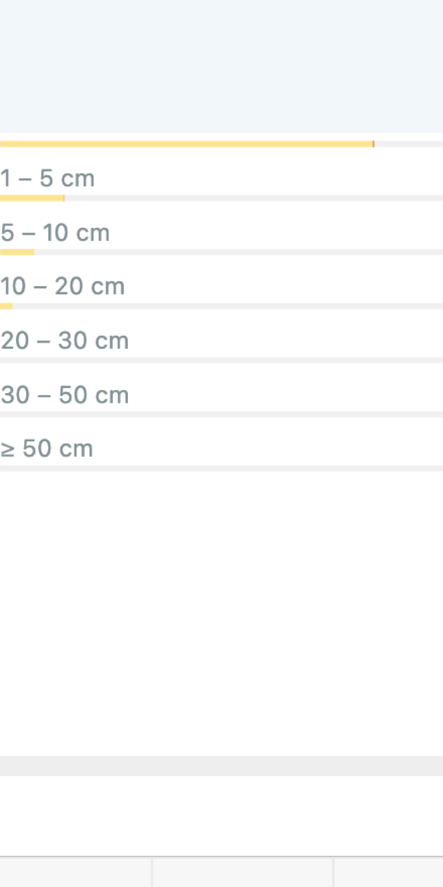
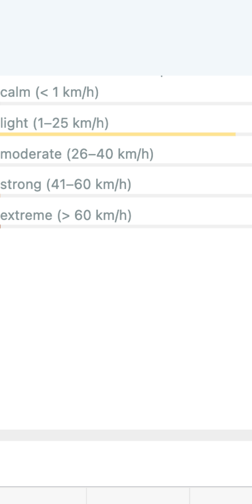
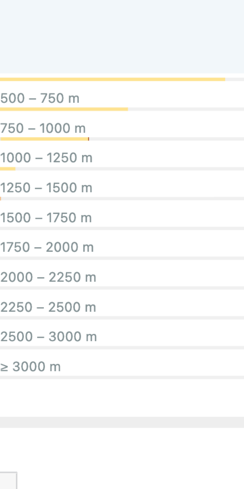

# Panels & Charts

There is one card for each panel on the right side of the dashboard, in the same order. Each card starts with what
the panel tells you. The technical details are folded away at the bottom.

**Location:** [Aspect & Elevation](#aspect-elevation) · [Elevation](#elevation) ·
**[Datetag](#datetag)** ·
**Stability:** [Sk38_CCL](#sk38_ccl) · [Punstable](#punstable) · [LWC Index](#lwc) · [Pwet](#pwet) ·
**[Avalanche Problem](#grain-type)** ·
**Weather Data:** [New Snow 24 h](#hn24) · [New Snow 48 h](#hn48) · [Rain 24 h](#rain24) ·
[Wind 24 h Mean](#vw24) · [Wind Direction 24 h](#dw24) · [Gust 24 h Max](#gust24) · [Air Temperature](#ta) ·
[Snowline](#snowline) · [Snow Level MSC](#snlvl) ·
**Charts:** [Hazard Chart](#hazard-chart) · [Time Series](#time-series)

## Panel Buttons { #panel-buttons }

Every panel header has the same four buttons:

| Button | Name | Does |
|---|---|---|
| :material-brush-variant: | **Classify** | colour the map by this variable |
| :material-tag-outline: | **Label** | show this variable as labels on the map |
| :material-circle-half-full: | **Invert** | swap the selection: everything that is not selected |
| :material-power: | **Reset** | clear this panel's filter |

Click a class to select only that class. ++shift++ + click adds a class, ++ctrl++ + click selects everything except
that class, and ++alt++ + click (or a long press) highlights a class instead of filtering.

**Without specification** counts the points that have no value. Examples: the snowline when no precipitation fell,
or the datetag when there is no critical layer.

!!! note "Reading the classes"
    The lower limit is included and the upper one is not: 5–10 cm means at least 5 cm and less than 10 cm.
    **24 h** always means the 24 hours ending at the time step shown, forecast steps included.

---

## Location

### Aspect & Elevation { #aspect-elevation }

**What it tells you:** where in the terrain the selected conditions are. It is the aspect × band view from the
avalanche bulletin.

**How to read it**

- **Wedges** are aspects (N, E, S, W, each ±45°). **Rings** are bands: alpine in the centre, below treeline on the
  outside.
- The rings have **equal area**, so every slice carries the same visual weight.
- **Flat** is the column on the right.
- Each slice is coloured by how its points split into classes.
- **Hover:** aspect · band, the variable that colours the map, the number of points and each class in %.

**Clicks**

- A slice → that aspect and band.
- An aspect label (N, E, …) → all bands of that aspect.
- A band label (Alpine, …) → that band in every aspect.

??? abstract "Technical details"
    | | |
    |---|---|
    | Key | `aspect` × `band` (cells such as `N|alpine`) |
    | Aspect | the simulated slope: flat or 38° N/E/S/W (stations: 8 aspects) |
    | Band | elevation band of the point, from the region GeoJSON (30 m vegetation-based DEM, so treeline follows vegetation) |
    | Band limits | depend on the operation, see [Operations](operations.md) |

### Elevation { #elevation }

**What it tells you:** how the selected points are spread over elevation, in 200 m steps.

- Bars are coloured by band: ALP · TL · BTL.
- **Elevation cut:** the blue marker (e.g. **22** = 2200 m) selects everything above or below that elevation.

??? abstract "Technical details"
    | | |
    |---|---|
    | Key | `elevation` |
    | Source | point elevation (30 m MRDEM, median of the member cells) |
    | Classes | < 1400, then 200 m steps up to 3200 + |

---

## Datetag { #datetag }

**What it tells you:** *when* the critical layer was buried. Use it to follow one weak layer across the operation
and through time, e.g. "the 2026-10-24 layer".

- Each bar is a burial date: the precipitation event that buried the layer.
- **Unburied new snow** and **Unburied old snow** mark critical layers that are still at the surface.
- The datetag belongs to the stability index that currently colours the map.

[Recipe: follow one buried layer →](how-do-i.md#follow-one-buried-weak-layer)

??? abstract "Technical details"
    | | |
    |---|---|
    | Key | `snowpack.<index>.instabilityDrivenBy` |
    | Method | layers grouped by the precipitation event that buried them, per region and band |
    | Code | [datetags](https://gitlab.com/avalanche-warning/snow-cover/postprocessing/instability/datetags) · [Herla et al. (2024), ISSW](https://gitlab.com/avalanche-warning/universal/archive/resources/-/raw/main/HerlaOthers2024_ISSW_Postprocessing.pdf) |

---

## Stability

Each index picks **one layer per point**: its most critical one. Datetag, Avalanche Problem (grain type) and the
depth in the hazard chart describe that same layer, for the index that currently colours the map.

| Use for | Indices |
|---|---|
| Dry snow | [Sk38_CCL](#sk38_ccl) (default) · [Punstable](#punstable) |
| Wet snow | [LWC Index](#lwc) · [Pwet](#pwet) |

### Sk38_CCL { #sk38_ccl }

**What it tells you:** how easily a skier could trigger the weakest buried layer. **Lower = less stable.** This is
the default colouring of the map.

Very Poor ≤ 0.3 Poor ≤ 0.75
Fair ≤ 1.05 Rather Stable > 1.05

??? abstract "Technical details"
    | | |
    |---|---|
    | Key | `snowpack.sk38_ccl.value` |
    | Meaning | skier stability index Sk38 of the weak layer combined with the critical cut length (AWSOME `sk38_ccl`). Sk38 below 1 is AWSOME's instability threshold. |

### Punstable { #punstable }

**What it tells you:** the probability (0–1) that the critical layer is unstable. **Higher = less stable.**

Very Poor ≥ 0.85 Poor ≥ 0.78
Fair ≥ 0.7 Rather Stable < 0.7

??? abstract "Technical details"
    | | |
    |---|---|
    | Key | `snowpack.Punstable.value` |
    | Method | random forest by [Mayer et al. (2022)](https://doi.org/10.5194/tc-16-4593-2022) over six layer features: viscous deformation rate, critical crack length, sphericity, grain size, skier penetration, slab density over grain size |
    | Note | persistent weak layer detection uses 0.77 as its "unstable" threshold |
    | Code | [punstable](https://gitlab.com/avalanche-warning/snow-cover/postprocessing/instability/punstable) |

### LWC Index { #lwc }

**What it tells you:** how wet the critical layer is. **Higher = more wet-snow instability.**

Unstable ≥ 3 % Transitional ≥ 1 %
Rather Stable < 1 %

??? abstract "Technical details"
    | | |
    |---|---|
    | Key | `snowpack.lwc.value` |
    | Meaning | liquid water content of the critical layer, %. 3 % is AWSOME's wet-instability threshold. |

### Pwet { #pwet }

**What it tells you:** the probability (0–1) of a wet-snow avalanche day. There is **one value per day**.

Very Poor ≥ 0.7 Poor ≥ 0.5
Fair ≥ 0.3 Rather Stable < 0.3

??? abstract "Technical details"
    | | |
    |---|---|
    | Key | `snowpack.pwet.value` |
    | Method | random forest by [Hendrick et al. (2023)](https://doi.org/10.1017/jog.2023.24) over liquid-water and weather features of the day's wettest profile |
    | Code | [pwet](https://gitlab.com/avalanche-warning/snow-cover/postprocessing/pwet) |

---

## Avalanche Problem { #grain-type }

**What it tells you:** the grain type of the critical layer. Persistent types (SH, DH, FC, FCxr) mean a layer that
can stay reactive for weeks.

| Code | Grain type | | Code | Grain type |
|---|---|---|---|---|
| PP | precipitation particles | | FC | faceted crystals |
| DF | decomposing fragments | | FCxr | rounding facets |
| PPgp | graupel | | RG | rounded grains |
| SH | surface hoar | | MF | melt forms |
| DH | depth hoar | | MFcr | melt-freeze crust |
| | | | IF | ice formation |

!!! info "Coming soon"
    The panel is named *Avalanche Problem* because it will show the avalanche problem type. For now it shows grain
    types.

??? abstract "Technical details"
    Key: `snowpack.<index>.grainType`

---

## Weather Data

snowpackbc computes these after SNOWPACK runs, from SNOWPACK's 3-hourly time series and HRDPS side products.

### New Snow 24 h { #hn24 }

**What it tells you:** settled new snow over the last 24 h, in cm, on the feature's slope.

Classes: < 1 · 1–5 · 5–10 · 10–20 · 20–30 · 30–50 · ≥ 50 cm

{ width="300" }

??? abstract "Technical details"
    | | |
    |---|---|
    | Key | `weather.hn24` |
    | Source | SNOWPACK `HN24`, the feature's slope |
    | Fix | the daily SNOWPACK restart writes 0 at 06Z. That row is rebuilt as HN24(t+3h) − HN3(t+3h) + HN3(t−21h). |

### New Snow 48 h { #hn48 }

**What it tells you:** new snow over the last 48 h, in cm. The classes are the same as for 24 h.

!!! warning "Slightly high"
    It adds two 24 h totals, so settlement between them is not accounted for.

??? abstract "Technical details"
    Key `weather.hn48` = `hn24(t) + hn24(t − 24 h)`

### Rain 24 h { #rain24 }

**What it tells you:** rain over the last 24 h, in mm. SNOWPACK decides whether precipitation falls as rain or snow.

Classes: < 0.1 · 0.1–2 · 2–5 · 5–10 · 10–25 · ≥ 25 mm

??? abstract "Technical details"
    | | |
    |---|---|
    | Key | `weather.rain24` |
    | Source | SNOWPACK rain rate (`MS_Rain`), mean of the window × 24, the feature's slope |

### Wind 24 h Mean { #vw24 }

**What it tells you:** the average wind speed over 24 h, in km/h. While it colours the map, it draws
[wind arrows](map.md#wind-arrows).

Avalanche Canada classes: Calm < 1 · Light 1–25 · Moderate 26–40 · Strong 41–60 · Extreme > 60 km/h

{ width="300" }

!!! bug "Known issue: station winds"
    Some station feeds (AvCan, Whistler Blackcomb) appear to be in km/h but are read as m/s. Station winds can look
    about 3.6× too strong. [Known issues →](known-issues.md)

??? abstract "Technical details"
    | | |
    |---|---|
    | Key | `weather.vw24` |
    | Source | mean of the forcing wind speed (HRDPS 10 m, or the station), flat |

### Wind Direction 24 h { #dw24 }

**What it tells you:** where the wind came **from** over the last 24 h, in 8 sectors.

{ width="300" }

!!! tip
    Wind from the SW loads NE-facing slopes. The [wind arrows](map.md#wind-arrows) on the map point *downwind*.

??? abstract "Technical details"
    | | |
    |---|---|
    | Key | `weather.dw24_sector` (degrees in `weather.dw24`) |
    | Method | vector mean of the 24 h, each hour weighted by its wind speed |

### Gust 24 h Max { #gust24 }

**What it tells you:** the strongest gust of the last 24 h, in km/h. The classes are the same as Wind 24 h Mean.

??? abstract "Technical details"
    | | |
    |---|---|
    | Key | `weather.gust24` |
    | Source | highest hourly HRDPS 10 m gust of the 24 h, median over the point's HRDPS cells |

### Air Temperature { #ta }

**What it tells you:** the air temperature at the time step, at the point's elevation, in °C.

Classes: < −20 · −20…−15 · −15…−10 · −10…−5 · −5…−2 · −2…0 · 0…2 · 2…5 · 5…10 · ≥ 10 °C

??? abstract "Technical details"
    Key `weather.ta` (elevation in `weather.z`). Source: the forcing air temperature (HRDPS lapse-rate corrected,
    or the station).

### Snowline { #snowline }

**What it tells you:** the elevation where precipitation changes from rain to snow, from our own calculation.
Compare it with [Snow Level MSC](#snlvl).

Classes: < 500, then 250 m steps to 2500, 2500–3000, ≥ 3000 m

!!! warning "Can be too low in cold, dry periods"
    It extrapolates surface temperatures, which are colder than the free air at night and in inversions. When no
    precipitation falls, the value is hypothetical. [Known issues →](known-issues.md)

??? abstract "Technical details"
    | | |
    |---|---|
    | Key | `weather.snowline` |
    | Method | 1. Take the point's forcing temperature and humidity. 2. Move them up and down in 50 m steps with the monthly lapse rates of the HRDPS correction. 3. Take the elevation where the **wet-bulb temperature is +1 °C**, where about half the precipitation falls as snow (wet-bulb after [Stull 2011](https://doi.org/10.1175/JAMC-D-11-0143.1)). 4. Over 24 h: precipitation-weighted mean when ≥ 1 mm fell, otherwise the median. |
    | Points | grid: each cell from its own temperature and elevation. Hexagons: every band takes the value of the region's below-treeline band (least extrapolation). |

### Snow Level MSC { #snlvl }

**What it tells you:** MSC's forecast snow level, in m. It only has a value where precipitation is forecast, and
only from 12 Oct 2026 on.

| Our snowline | MSC snow level |
|---|---|
|  |  |

??? abstract "Technical details"
    Key `weather.snlvl`. Source: HRDPS WEonG `HGTSNLVL`, median of the point's cells and of the hours that have a
    value.

---

## Charts

### Hazard Chart { #hazard-chart }

**What it tells you:** how weak *and* how deep the critical layers are, all in one view.

- **Y-axis:** the stability index that colours the map. For Sk38_CCL, 0 is at the top, so less stable points sit
  higher.
- **X-axis:** the depth of its critical layer, in cm, on a scale binned like avalanche size classes.
- **Dots:** one per selected point, coloured by class. The dashed lines are the class limits.
- Hovering the map highlights the matching dot.

??? abstract "Depth classes"
    Key `snowpack.<index>.size_estimate`: 1: 0–26 cm (small) · 2: 26–53 (medium) · 3: 53–110 (large) ·
    4: 110–225 (very large) · 5: 225 + (extreme)

### Time Series { #time-series }

**What it tells you:** how the stability index of the selected point developed over the last **14 days**, and the
next **3 days**.
